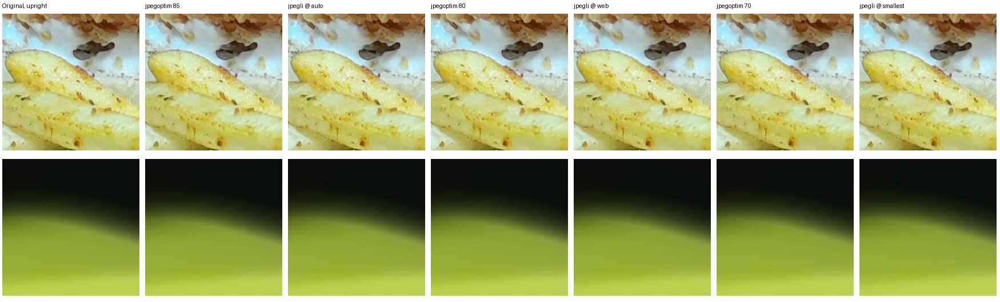
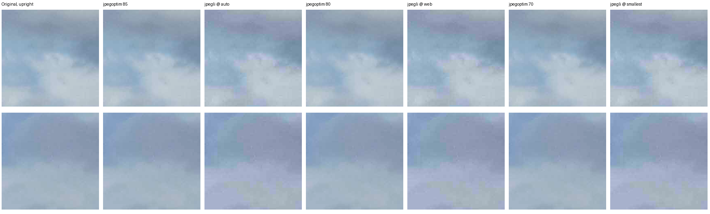

# Native JPEG backend comparison, 21 October 2026

## Meaning

This bounded Linux comparison measures the existing jpegoptim application path against pinned upstream cjpegli on two CC0 photographs and four color controls. All six cjpegli byte targets were met, but direct CMYK input failed and the grayscale profile was lost. Katja recommends retaining jpegoptim: the inspected crops do not establish a quality gain sufficient to justify a new backend and preservation/distribution work. This is a decision-ready comparison, not a universal codec ranking or acceptance of JPEGli. Product judgment remains in [Issue #57](https://github.com/Wolfsblvt/smolpng/issues/57); no application backend or 85/80/70 default changes here.

## Exact specimen and reproduction

- smolpng/helper source: `1137e1ac8fca83bd9d472d337a310dd183f4d632`; application SHA-256 `b1c1a92b7640247928ad83fa56a6e66d5c94be699786aa65a7d700267f7e4308`.
- [Successful native run 39672787597](https://github.com/Wolfsblvt/smolpng/actions/runs/39672787597): Ubuntu 24.04.5 amd64, runner image `ubuntu24/20261012.334.1`, Go 1.26.6, GCC 13.3.0, CMake 3.31.6, Python 3.12.15, Pillow 12.3.0, LittleCMS 2.19. One thread was selected through `OMP_NUM_THREADS=1`.
- jpegoptim 1.5.6: existing managed Linux amd64 archive SHA-256 `f480db3bdda996cb1ed366f0877f2fe9e0d8708487f7d00e4c7166b52a9e2c1a`, executable SHA-256 `279800dabce2e03916560cefbefb307cd05c8f75430f24e79729ede1d8a5da8a`.
- JPEGli [source](https://github.com/google/jpegli/tree/031a0077f5799a6041004267fc12b956c1f52a20) `031a0077f5799a6041004267fc12b956c1f52a20`; cjpegli SHA-256 `cac47c811b066fefb52faccb3756f00dbea23eda6db968dcdfca9992116f670b`. The archive build reports version `(unknown)`; its identity is the pinned source and executable digest, not an invented release version.
- Upstream's pinned dependencies: Highway `271a9a0ed9de1232d9117f1572c3fe28f8542ec1`, skcms `96d9171c94b937a1b5f0293de7309ac16311b722`, libjpeg-turbo headers `8ecba3647edb6dd940463fedf38ca33a8e2a73d1`. The workflow records all source-archive hashes and build logs; it builds only cjpegli, without workstation installation or redistribution of its executable.
- The byte-exact [report](2026-10-21-jpeg-backends/report.json), SHA-256 `9274a17fc13e6abe65f59bfa163530fda15dd9172395fd2a1f75d7a96469830b`, retains commands, original/prepared/output hashes, bytes, dimensions, orientation, profiles, diagnostics and elapsed times. Its `complete` means all comparative outcomes were captured, including candidate failures.

The narrowly filtered `JPEG backend comparison` workflow and [Development command](../DEVELOPMENT.md#jpeg-backend-comparison) reproduce this special journey. It is separate from ordinary Go verification. The hosted artifact `jpeg-backends-1137e1ac8fca83bd9d472d337a310dd183f4d632-39672787597` retains full candidate images, prepared PNGs, licenses and logs for its 14-day artifact lifetime. The committed report and pixel crops preserve the useful result beyond that transport lifetime; original images remain in the canonical hash-bound corpus.

## Actual file-size comparison

Each baseline is the existing application consuming the original JPEG with its selected 85/80/70 quality range, offline policy and Safe metadata. cjpegli consumes an independently decoded, upright sRGB PNG and requests the baseline's actual byte count with `--target_size`. Quality numbers are not transferred between encoders. All original hashes were rechecked unchanged.

| Photograph / jpegoptim reference | jpegoptim bytes | cjpegli bytes | Target met |
| --- | ---: | ---: | --- |
| Food / Auto 85 | 287155 | 286680 | yes |
| Food / Web 80 | 227579 | 226544 | yes |
| Food / Smallest 70 | 161307 | 161175 | yes |
| Clouds / Auto 85 | 276012 | 275731 | yes |
| Clouds / Web 80 | 276012 | 275731 | yes |
| Clouds / Smallest 70 | 276012 | 275731 | yes |

The three cloud baselines are byte-identical and independently pixel-identical to the original when viewed through its profile. They are one distinct outcome, not three independent quality observations. The Food original also has 1799549 bytes of camera attachment; removing that payload under Safe is separate from encoder savings and is reported by the application.

These are matched-size results, not an assertion that the candidate saves a large percentage at equal perceptual quality. The candidate's byte search was within 0.46% below each target. This sample does not establish cjpegli's exact target behavior for arbitrary inputs.

## Independent viewing and bounded judgment

Pillow/LittleCMS normalizes orientation and converts tagged data to sRGB with perceptual intent for channel diagnostics and crops. Untagged RGB assumes sRGB; untagged CMYK uses an explicitly unmanaged conversion. The Food reference is already JPEG-decoded data, not a camera raw or lossless photographic master. The cloud reference is converted from its original ICC profile for candidate preparation; the original profile remains on the jpegoptim outputs. These conversion and recompression costs are part of this comparison's interpretation.

On Food, mean absolute channel error ranges from `0.746–0.861` for jpegoptim 85 versus `0.778–1.062` for matched cjpegli, and `1.151–1.448` versus `1.357–1.987` at the smallest budget. On Clouds, jpegoptim is exactly identical under this viewing transform; cjpegli has mean errors `2.780 / 2.028 / 3.873` and maxima `48 / 48 / 60` on 8-bit channels. These are full-image diagnostics, not perceptual scores or a quality veto.

Katja inspected both sheets below. cjpegli smooths the Food image's dark gradient, with visible differences in fine food texture. The cloud crops show visible color/tonal shifts compared with the identical jpegoptim baseline. That is a bounded visual judgment on two locations per image, not a whole-library blind study or Wolf's taste decision. Full images remain in the native artifact for closer inspection.

Both sheets contain two 240-by-240 original-pixel crops per column, left to right: original, jpegoptim 85, matched cjpegli, jpegoptim 80, matched cjpegli, jpegoptim 70, matched cjpegli. Viewer scaling may resize the sheet; open its image to inspect the original pixels.

The images are CC0 derivatives of the existing admitted photographs. Their source, publisher dedication and exact original hashes remain in `testdata/corpus/manifest.toml`; no new photographic source was admitted.

## Preservation and operating cost

| Direct original-JPEG control | cjpegli observation |
| --- | --- |
| Untagged CMYK | exit 1, `Failed to decode input image` |
| ICC-tagged CMYK | exit 1, same decoder refusal |
| ICC-tagged grayscale | 4460 to 1772 bytes, still grayscale, original ICC absent |
| Display P3 RGB | 3829 to 1994 bytes, RGB and exact ICC preserved; lossy pixels differ |

These observations apply to this built cjpegli CLI and invocation. They do not prove the JPEGli library can never support a repair or an adapter. The existing application/jpegoptim contracts already have independent native qualification; blindly swapping executable names would not preserve them. An optional future JPEGli route would need original-derived preparation, honest profile handling, CMYK fallback and retained lossless behavior, without silently shrinking the selected supported estate.

Photographic cjpegli subprocess times were 0.446/1.342/0.584 seconds on Food and 2.458/2.483/2.477 seconds on Clouds. The application calls were 1.517/1.462/1.422 and 2.790/2.801/2.788 seconds respectively. These are unequal boundaries: the application includes recipe selection, safety validation and output commit; cjpegli receives prepared PNG data, with an additional 1.085/2.153 seconds of one-time independent reference preparation per photograph. The single hosted sample is not a speed ranking. The complete comparative step took about 29 seconds; upstream source preparation/build took about 57 seconds.

This source build also depends dynamically on system libjpeg, libpng, zlib, libstdc++, libgcc, libc and libm. `BUILD_SHARED_LIBS=OFF` did not make a self-contained distribution. A production offer would therefore need platform-specific build/distribution qualification or an independently qualified binary route. No new runtime dependency, managed tool catalog entry, package or codec-linking commitment was made.

## Initial failure and current consequence

The first [run 39671668576](https://github.com/Wolfsblvt/smolpng/actions/runs/39671668576) at `e7ec7b3bc28e65e69599d6ae2cd1d0389ab090f5` failed during CMake configuration before compression: `jconfig.h.in`, `jpeglib.h` and `jmorecfg.h` were absent. Upstream `lib/jpegli.cmake` copies its pinned libjpeg-turbo headers even with the shared replacement disabled. Commit `1137e1a` adds that exact source from upstream `deps.sh`; the corrected native run completed. Ordinary Verify at `1137e1a` also passed all eleven jobs. Fixture-double success before the native run did not establish the native build or CLI.

Katja recommends retaining jpegoptim and closing this exploration after Nyxara's product judgment. The result preserves a reproducible comparison if new images, a changed upstream preservation path, or a demonstrated quality benefit later earns reopening. It does not remove JPEGli as a possible future choice, defer the existing useful JPEG product, complete the full 1.0 destination, or qualify the held graphical journey. Wolf's reply in the active implementation conversation was: “Ask Nyx in the room, but I feel like yes, we should keep jpegoptim and not continue the jpegli exploration.” The owning room carries that request and Nyxara's disposition.
