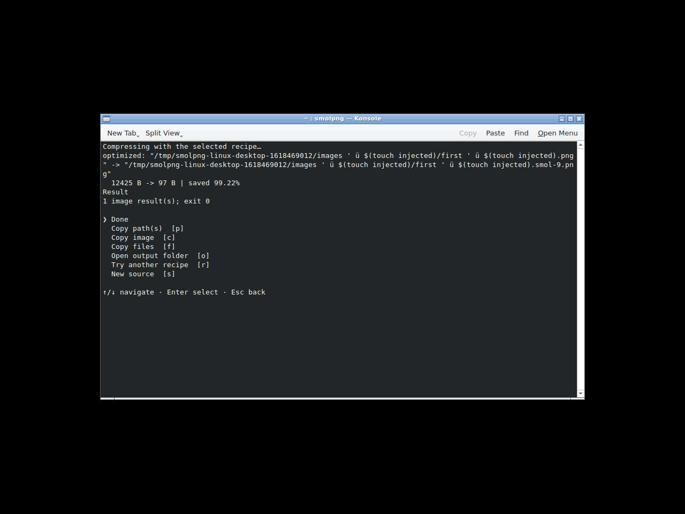

# Native Linux launcher and Dolphin qualification

## Meaning

The source candidate passed a complete native GLib/Dolphin journey on one disposable Ubuntu 24.04 amd64 X11 desktop: background and configured foreground operation, PNG/JPEG selections, original protection, explicit replacement and owned integration removal. It repaired two observed application defects: an unsupported jpegoptim 1.4 flag and configured interactive Auto launch without a terminal. This record preserves the successful result and all twelve hosted attempts. It qualifies this source/host boundary rather than physical desktops, other distributions, Wayland, private candidate archives or publication.

## Source and host

Application source: `d573d602eb472e74727ceaefdf424239f6b7aedd`, proposed in [PR #74](https://github.com/Wolfsblvt/smolpng/pull/74) for [Work #73](https://github.com/Wolfsblvt/smolpng/issues/73), based on accepted `d91b9818494e08adce4cca8d802e0363d2b62d8b`. All eleven [Verify jobs](https://github.com/Wolfsblvt/smolpng/actions/runs/39732474626) passed. The [complete native run](https://github.com/Wolfsblvt/smolpng/actions/runs/39732474672) passed `TestNativeLinuxDesktop` in **213.95 seconds**, with `complete=true` and `passed=true`. Forgehand passed; the legacy size workflow was intentionally skipped.

Host: Ubuntu **24.04.5 LTS**, Linux `6.17.0-1022-azure` x86_64, runner image `ubuntu24 / 20261012.334.1`; Go **1.26.6**, `CGO_ENABLED=0`. The virtual X11 session used Xvfb `21.1.12`, Openbox `3.6.1`, Dolphin/Konsole `23.08.5`, GLib `2.80.0`, AT-SPI `2.52.0` and D-Bus `1.14.10`. System optimizers were pngquant **2.18.0** and jpegoptim **1.4.7**; OxiPNG **10.2.1** was explicitly installed through the ordinary managed route into the isolated application home. No optimizer was bundled.

The source-built application SHA-256 was `1dee06ffe8dcf79aa95e4666fb178ac497b0de09687dc01b370cda51b9e082a1`; the test executable was `305017e9a96d2e0fe158fcfad9a0caef3ea07dc1860699dd1577c04e581add50`. The successful test log is `2448b526e233534a2da94e5041a3e90beb521c3fdd5322a5755e55d8615d8b38`. This is related-source evidence, not execution of immutable `0.3.0-dev.12` archives at `61b3ea59`.

## Observed behavior

- GLib menu/desktop entries launched one PNG and a mixed PNG/JPEG batch. Executable/config/input paths contained spaces, Unicode, quotes and literal shell-sensitive text. Last-result inputs retained their ordered original paths; every output decoded.
- Dolphin single actions and submenu Auto/Lossless actions reached the shared application. Lossless explicitly reported the selected lossless recipe. The native process trace records actual application handoff; key delivery alone was not counted as compression.
- Explicit desktop, Dolphin and configured Auto-entry interactive flows each displayed the recipe picker, committed output, displayed Result and completed Done in native Konsole. Setting `drop.mode=interactive` required no launcher reinstall.
- Originals stayed byte-identical. Explicit replacement used separate generated copies and returned those exact input paths as outputs. Ten last-result reports and public `last --json` reads established recovery.
- Repeated installation was safe. Two expected exit-5 refusals preserved modified launcher bytes. After restoring only the fixture's owned bytes, removal completed. Both final native status reads had empty entry sets and `recoveryPending=false`.
- The existing native JPEG qualifier passed all **51 checks** against actual jpegoptim 1.4.7, including metadata/color controls. No backend/default change or TinyPNG upload followed.

The desktop journey retained **101 command receipts**: 99 successful commands and two expected protected-content refusals. Optimizer checks and desktop actions prove their separate exercised boundaries.

This is provisional existing presentation, not final icon, language or design acceptance.

## Repairs and earlier attempts

The admitted jpegoptim 1.4.7 rejected `--keep-all`. Its equivalent `--strip-none` works on that line and the newer backend. An ordinary regression protects the admitted version; the 51 native checks establish the real system-tool consequence. Original-derived candidates and metadata policies remain unchanged.

An Auto desktop entry starts without a terminal even when configuration later selects interactive drop. The old path emitted `interactive mode needs a terminal`. The repair reuses the existing desktop-entry encoder and GLib `gio launch` with a private temporary `Terminal=true` entry containing the original invocation. The desktop selects its terminal; `gio` is an explicit prerequisite for this configured foreground route. The entry is removed after the launch request, and the child owns completion/history. Background operation opens no terminal. No shell, emulator registry, Go dependency, setting reset or provider-policy change was added.

| Native run | Source prefix | Result |
| --- | --- | --- |
| [39725136747](https://github.com/Wolfsblvt/smolpng/actions/runs/39725136747) | `b98eb4d6` | GLib PNG passed; an empty JPEG fixture prevented the mixed case. |
| [39725504131](https://github.com/Wolfsblvt/smolpng/actions/runs/39725504131) | `53da975e` | Valid JPEG exposed unsupported `--keep-all`. |
| [39726054419](https://github.com/Wolfsblvt/smolpng/actions/runs/39726054419) | `fd8ee6ff` | PNG/JPEG launcher output/last passed; Shift+F10 did not open the file menu. |
| [39726522012](https://github.com/Wolfsblvt/smolpng/actions/runs/39726522012) | `ab0c0369` | Blank icon space opened the folder menu. |
| [39726853505](https://github.com/Wolfsblvt/smolpng/actions/runs/39726853505) | `b39c59ba` | Make smol was visible; Qt omitted popup actions from accessibility child traversal. |
| [39727300646](https://github.com/Wolfsblvt/smolpng/actions/runs/39727300646) | `ee7715de` | Superseded/cancelled workflow; retained test log also records popup-lookup timeout. The unhelpful Qt bulk-cache experiment was removed. |
| [39727506380](https://github.com/Wolfsblvt/smolpng/actions/runs/39727506380) | `c342823a` | Initial native menu navigation produced no new result. |
| [39728653203](https://github.com/Wolfsblvt/smolpng/actions/runs/39728653203) | `11d80778` | Trace showed no app handoff; screen showed Properties. Qt End scrolls instead of selecting the final action. |
| [39730265352](https://github.com/Wolfsblvt/smolpng/actions/runs/39730265352) | `aea2c71e` | Up/Up passed Dolphin single/many and explicit desktop terminal completion. Submenu accessibility lookup failed; all 51 JPEG checks passed. |
| [39730840937](https://github.com/Wolfsblvt/smolpng/actions/runs/39730840937) | `5b0f3380` | Auto/Lossless submenu passed. Earlier Dolphin processes filled the traversal before a later file cell. |
| [39731388849](https://github.com/Wolfsblvt/smolpng/actions/runs/39731388849) | `3c9ee8e1` | Owned process cleanup fixed traversal; Dolphin interactive completed. Configured foreground Auto launch failed without a terminal. |
| [39732474672](https://github.com/Wolfsblvt/smolpng/actions/runs/39732474672) | `d573d602` | Complete desktop journey and all 51 JPEG checks passed. |

The fixture uses native X11 menu navigation where Qt omits popup children, and AT-SPI for file cells and terminal text. It stops each owned Dolphin process group when its case closes instead of accumulating stale objects. These fixture repairs changed no product UI.

## Retained originals and limits

The [payload](2026-10-22-native-linux-desktop/report.json) reconstructs **1,162 original files / 8,939,211 bytes** from all twelve downloaded artifacts. It retains per-file paths, byte counts and SHA-256 values with deduplicated base64 blobs, including reports, command/exec traces, generated fixtures/outputs and screenshots. Every stored file was independently decoded and rehashed after writing. Payload: **6,954,412 bytes**, SHA-256 `96fee028a1f565f2be77dd10669f709e8d32f10267b256bb7ff2fafff245c549`. This is an authored envelope around original runner bytes, not an original hosted artifact. Application/test/optimizer binaries are excluded.

These generated-fixture observations do not establish physical desktop feel, Wayland desktop behavior, other file managers/distributions/architectures, rendered notifications, clipboard paste, private archive runtime, public packaging or release. Separate [native clipboard evidence](2026-10-22-native-clipboard.md) remains protocol/API qualification. [Development](../DEVELOPMENT.md#native-linux-desktop-journey) owns the opt-in execution route.
